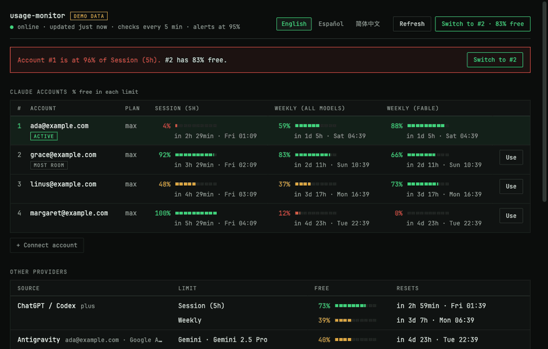
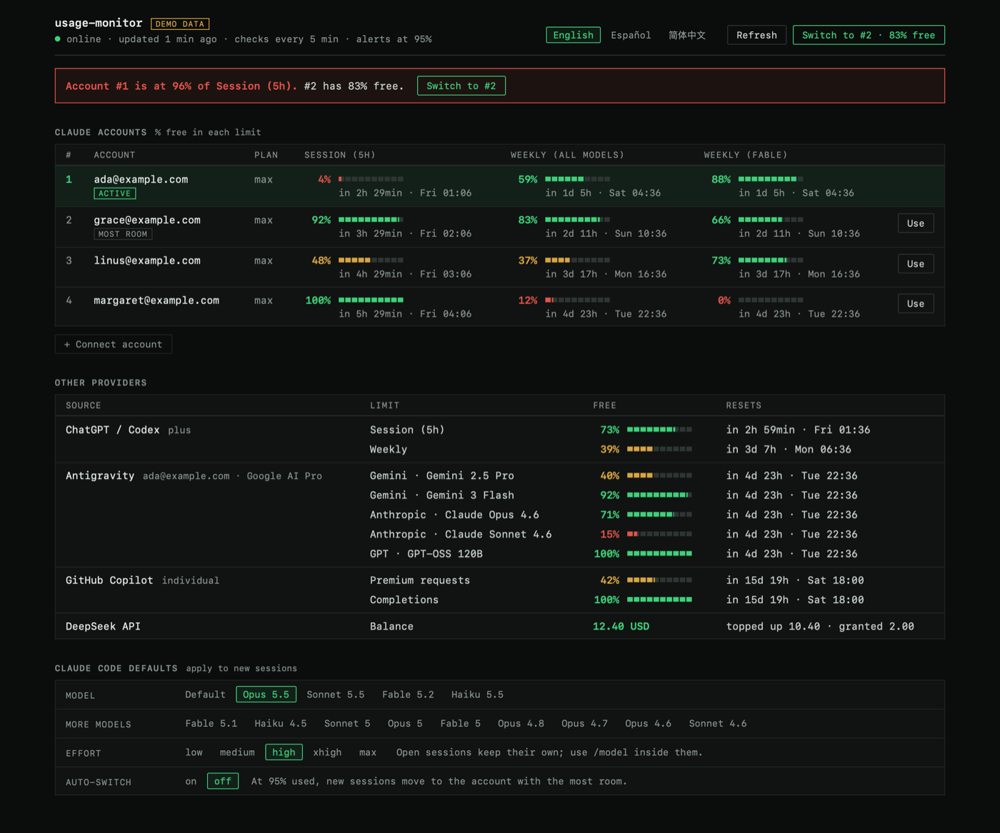
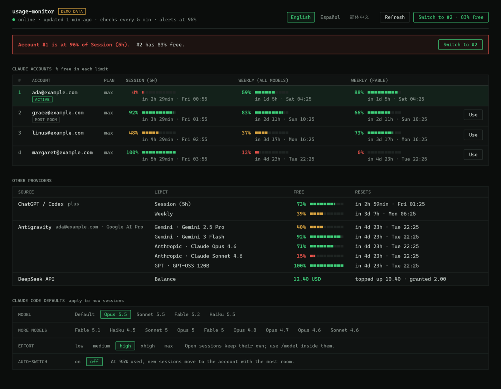
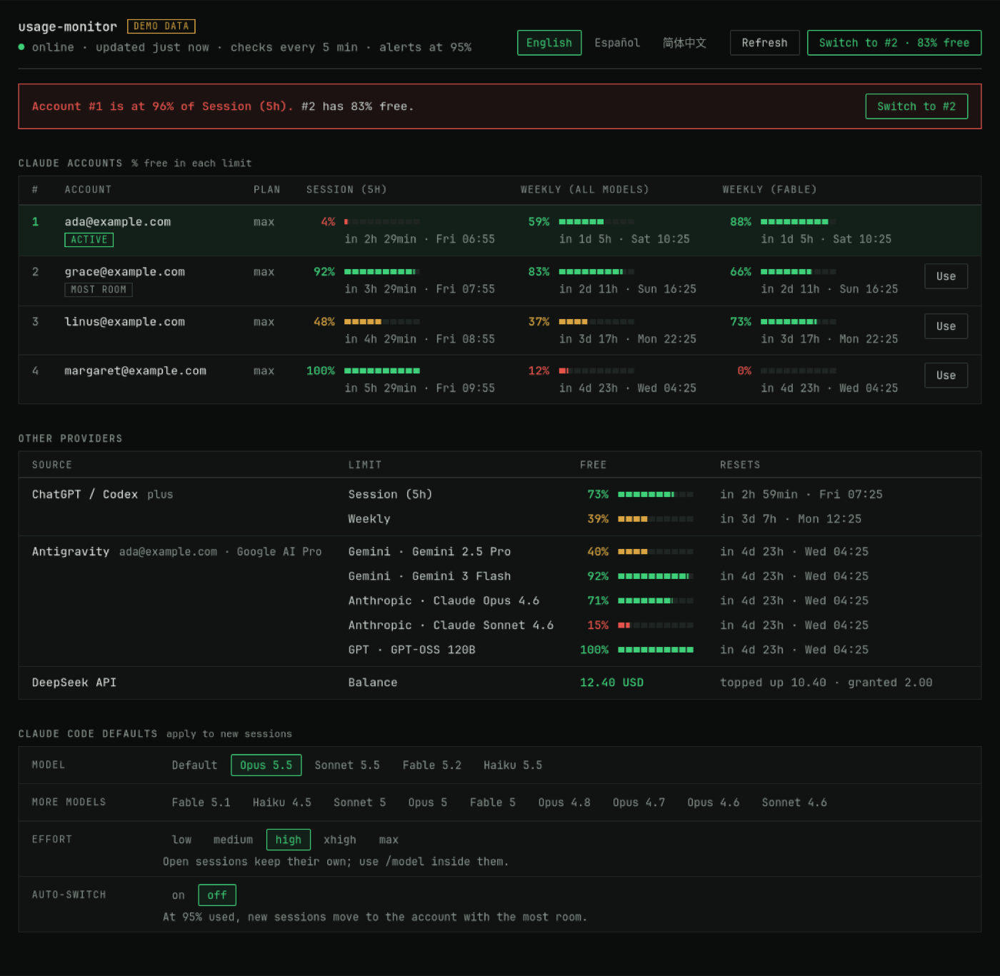

# usage

**Never run out of AI.** See what is left in every AI subscription you pay for — several Claude accounts,
ChatGPT/Codex, GitHub Copilot, Antigravity and DeepSeek — and let Claude Code move to the account with the most
room when one runs out, reopening the same conversation there.



| macOS | Windows | Linux |
| --- | --- | --- |
|  |  |  |

## Why

- **No more checking five websites.** Every limit, what is free and when it resets, in one table: in the menu bar,
  the tray, a window, the terminal or inside Claude Code.
- **No more being cut off mid-task.** At 95% you get an alert; with automatic switching, Claude Code finishes its
  reply, closes and reopens the same conversation on the next account by itself.
- **Nothing leaves your machine** except each tool's own request to its own provider.

## What it covers

- **Claude** (Pro/Max, as many accounts as you have; add one with a button), **ChatGPT/Codex**, **GitHub Copilot**
  (premium requests), **Antigravity** (per-model quota: Gemini, Claude, GPT) and **DeepSeek** (API balance).
- Desktop alerts at 95%, manual or automatic account switching, Claude Code's default model and effort.
- Native apps for macOS (SwiftUI), Windows (WPF) and Linux (GTK 4), a web panel, a Claude Code plugin and a CLI.
- English, Spanish and Simplified Chinese.

> **Unofficial project.** It reads the sessions that Claude Code, Codex CLI, GitHub Copilot, Antigravity and
> opencode already keep on your machine, and uses them to query the same internal services those tools use to show
> their usage. Those services are undocumented and can change without notice. Credentials never leave your machine
> except to their own provider, and this tool never refreshes or modifies them.

## Install

Download the installer for your system from [Releases](../../releases):

| System | File | First launch |
| --- | --- | --- |
| macOS (Apple Silicon / Intel) | `UsageMonitor-<version>-arm64.dmg` / `-x86_64.dmg` | Drag to Applications, then right-click → **Open** |
| Windows x64 | `UsageMonitor-<version>-win-x64.zip` | Unzip, run `UsageMonitor.exe`, then **More info → Run anyway** |
| Debian / Ubuntu | `usage-monitor_<version>_all.deb` | `sudo apt install ./usage-monitor_<version>_all.deb` |

> **The installers are not signed yet.** macOS Gatekeeper and Windows SmartScreen warn the first time you open
> them; the steps above get past the warning. Check the download against `SHA256SUMS.txt` on the release page.

Command line only, on any system with [uv](https://docs.astral.sh/uv/):

```sh
uv tool install git+https://github.com/full-stack-dev-johncastrosanabria/usage-status-monitor
usage            # status of every account
usage panel      # open the panel
```

## Commands

| Command | What it does |
| --- | --- |
| `usage` | Available usage of every account (`usage status --json` for scripts) |
| `usage current` | Only the active Claude account |
| `usage switch [N]` | Make account N active, or the one with the most room |
| `usage autoswitch on\|off` | Switch automatically when the active account hits the threshold |
| `usage claude [...]` | Run Claude Code with the active account; moves it to the next one when you switch |
| `usage connect` | Sign in another Claude account (opens the browser) |
| `usage model [M]` · `usage effort [E]` | Claude Code's default model and effort |
| `usage panel` | Open the panel (and start the local server) |
| `usage autostart on\|off` | Open the panel when you log in |
| `usage sync` | Share configuration and conversations across accounts |
| `usage lang [en\|es\|zh]` | Interface language |
| `usage watch` | Keep refreshing in the terminal |
| `usage config` | Create or show the configuration file |

### Several Claude accounts

Claude Code keeps each account in a configuration folder. The main one is `~/.claude`; add the others with
**+ Connect account** in the panel or `usage connect`: it signs a new `~/.claude-N` folder in through your browser
and shares your configuration and conversations with it (`usage sync`). Folders you made by hand
(`CLAUDE_CONFIG_DIR=~/.claude-work claude`, then `/login`) are found too.

`usage` finds every signed-in `~/.claude-*` folder by itself. To make `claude` always use the active account, add
an alias to your shell:

```sh
alias claude='usage claude'                 # bash / zsh
function claude { usage claude @args }      # PowerShell
```

A Claude Code session cannot change account while it is open. With shared conversations (`usage sync`), after
switching you only need to exit and run `claude --continue` to carry on the same conversation with the new
account. Sessions started through `usage claude` (or the alias above) with the plugin installed do it for you:
when another account is selected, the launcher waits until Claude finishes its reply, closes it and reopens the
same conversation on the new account. If the old account ran out mid-reply, it reopens at once and asks Claude to
continue where it left off.

### Automatic switch

With `usage autoswitch on` (or the toggle in the panel), when the active account reaches the threshold the
account with the most room becomes the active one and you get a notification. It runs while the panel server or
the app is running, and it only switches to an account that is not over the threshold itself.

### Panel

`usage panel` opens the panel in its own window: the native app on macOS if it is installed, or an
Edge/Chrome/Chromium window in app mode; otherwise a tab in the default browser. The server only listens on
`127.0.0.1` and rejects requests coming from other websites.

### Native apps

The apps start the local server when nothing answers and stop it when they quit. Building them yourself:

```sh
scripts/build-app.sh                               # macOS: ~/Applications/UsageMonitor.app (Xcode tools)
pwsh scripts/build-windows.ps1 -Runtime win-x64    # Windows: dist/windows/win-x64/UsageMonitor.exe (.NET 8)
scripts/build-deb.sh                               # Linux: dist/linux/usage-monitor_<version>_all.deb
```

macOS adds a menu bar indicator and Windows a tray icon, both with the % free on the active account.

### Claude Code plugin

```
/plugin install usage-monitor --marketplace full-stack-dev-johncastrosanabria/usage-status-monitor
```

Adds `/usage-monitor:status` and `/usage-monitor:switch`, and tells the session when its account goes over the
threshold or when you selected another account. It needs `usage` on the `PATH`.

## Configuration

`~/.config/usage-monitor/config.toml` (create it with `usage config`):

```toml
claude_order = ["main@example.com", "other@example.com"]  # order of the accounts
alert_at = 95            # % used that triggers an alert and the automatic switch
port = 8787              # local port of the panel
refresh_seconds = 300    # how often usage is fetched (minimum 60)
language = "en"          # "en", "es" or "zh"
auto_switch = false
```

What you change from the panel or the CLI (language, automatic switch) is saved next to it in `prefs.json` and
takes precedence.

## Platform support

| | macOS | Linux | Windows |
| --- | --- | --- | --- |
| Claude, ChatGPT/Codex, Copilot, DeepSeek | ✅ | ✅ | ✅ |
| Antigravity | ✅ | Secret Service (`secret-tool`) | Credential Manager |
| Alerts | Notification Centre | `notify-send` | Windows notification |
| Native app | SwiftUI (macOS 14+) | GTK 4 | WPF (.NET 8) |
| Start at login | LaunchAgent | `~/.config/autostart` | Startup folder |

Day-to-day development happens on macOS. The test suite runs on all three systems in continuous integration, and
the Linux and Windows apps were checked on Debian (Docker), Kali and Windows 11 virtual machines.

## Development

```sh
uv sync
uv run pytest
uv run ruff check && uv run ruff format --check
uv run mypy
```

Each provider lives in `src/usage_monitor/providers/` and exposes a `fetch()` and a pure `parse()`, which is what
the tests cover. Interface text is English in the code; `src/usage_monitor/i18n.py` holds the Spanish and Chinese
catalogues, and a test fails if a string is missing from either.
